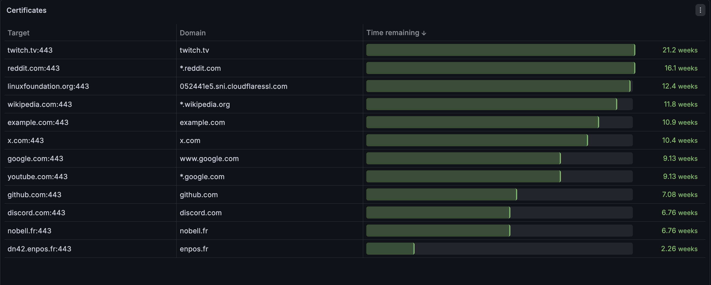

# SSL Exporter

SSL exporter is a simple ssl certificate expiration delay gatherer written in go. \
The expiration delay metrics are defined in seconds and exported for Prometheus on the `/metrics` endpoint. \
A bearer token can be configured for security needs.


## Running SSL exporter
SSL exporter can be run in a docker container or as a systemd service.

### Running on Docker
Install Docker
```bash
curl -fsSL https://get.docker.com | sh
```
Download the docker compose file
```bash
wget https://github.com/janbellon/ssl_exporter/releases/download/v0.1.1/docker-compose.yml
```
Edit the environment variables in `docker-compose.yml` if needed. \
Generate a bearer token and launch the ssl_exporter container
```bash
echo "SSL_EXPORTER_LISTEN_BEARER=$(openssl rand -hex 32)" > .env
chmod 600 .env
docker compose up -d
```

### Running as a systemd service
Download the ssl_exporter binary
```bash
wget https://github.com/janbellon/ssl_exporter/releases/download/v0.1.1/ssl_exporter-linux-amd64
```
Move the binary to bin directory
```bash
mv ssl_exporter* /usr/local/bin/ssl_exporter
```
Copy the systemd service file to systemd directory
```bash
cp ssl_exporter.service /etc/systemd/system/
```
Create a ssl_exporter user
```bash
useradd -M -s /bin/false ssl_exporter
```

Create the ssl_exporter configuration
```bash
mkdir /etc/ssl_exporter
cp config.sample.yaml /etc/ssl_exporter/config.yaml
chown root:ssl_exporter /etc/ssl_exporter/config.yaml
chmod 640 /etc/ssl_exporter/config.yaml   # the file contains the bearer token
```

Edit the configuration
```bash
vim /etc/ssl_exporter/config.yaml
```

```yaml
listen:
  host: 0.0.0.0
  port: 9123
  bearer: "<output of: openssl rand -hex 32>"

client:
  timeout: 30

log_level: info
```

## Configuring prometheus
To scrape metrics, add these lines to your `prometheus.yml` file
```yaml
- job_name: ssl-exporter
  metrics_path: /metrics
  scrape_interval: 5m
  scrape_timeout: 30s
  static_configs:
    - targets:
        - example.com:443
        - google.com:443
        - api.mycompany.com:8443

  authorization:
    type: Bearer
    credentials: "<your bearer token>"

  relabel_configs:
    - source_labels: [__address__]
      target_label: __param_target

    - source_labels: [__param_target]
      target_label: instance

    - target_label: __address__
      replacement: ssl-exporter:9123  # Replace with your ssl_exporter endpoint
```

## Security considerations
- The exporter opens a TLS connection to **any** `host[:port]` given in the `target` parameter.
  Always set a strong bearer token when it listens on anything else than localhost, and
  restrict network access to the port (firewall / private network). A warning is logged at
  startup when no token is configured on a non-loopback address.
- The bearer token is sent in clear text over HTTP. Put the exporter behind a TLS reverse
  proxy if the scrape traffic crosses an untrusted network.
- Prefer the config file or the `SSL_EXPORTER_LISTEN_BEARER` environment variable over the
  `--bearer` flag, which is visible in the process list.
- A target must be `host`, `host:port` or `[ipv6]:port` (default port 443); at most 100
  targets are accepted per request. Only a TLS handshake is performed, no HTTP request is sent.

## Grafana sample dashboard
A Grafana dashboard is available in `grafana_dashboard.json`
Import new dashboard in Grafana and paste file's content in the json input.
